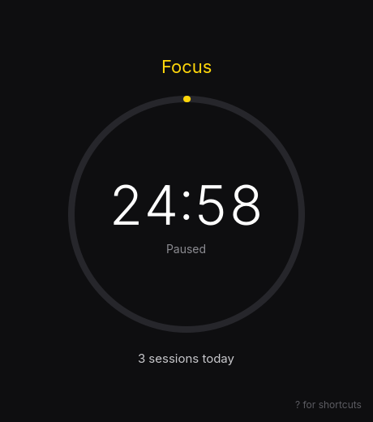

# Pomo



A keyboard-driven Pomodoro timer for [Omarchy](https://omarchy.org). 25 minutes of focus,
then a 5 minute break, with a 15 minute break after every fourth session. It follows the
Omarchy theme accent and language live, sends a desktop notification when a timer ends,
and counts the focus sessions you finish each day.

Each new phase waits for you to press Space, so a break never starts while you're away.

## Shortcuts

| Key   | Action                  |
|-------|-------------------------|
| Space | Start or pause          |
| R     | Reset this timer        |
| S     | Skip to the next phase  |
| ?     | Show or hide shortcuts  |
| Q     | Quit (asks while running) |

## Build and install

```sh
bin/build     # build/pomo
bin/test      # Qt Test, offscreen
bin/install   # makepkg -fsi, adds Pomo to the app launcher
```

Today's count lives in `~/.local/state/pomo/today`.
